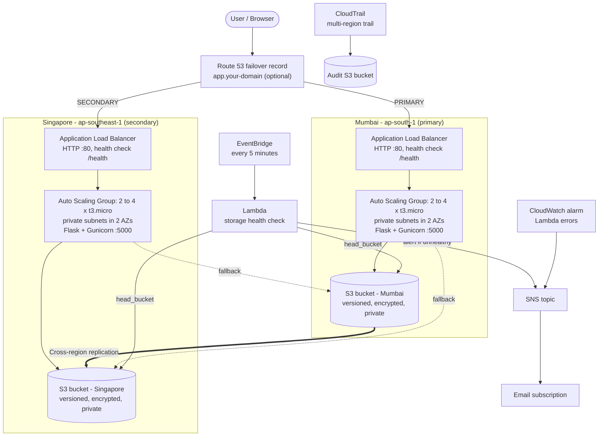

# Self-Healing Cloud Storage Using AWS Multi-Region Architecture

A Terraform project that **protects stored data from a regional disaster or an accidental deletion**. A small file-storage web application runs in **two AWS regions** (Mumbai and Singapore): every file is copied across regions, earlier versions of files are kept, and each region can keep serving the data if the other is lost. The stack also replaces failed servers, falls back to the other region's storage when one is unavailable, and sends alerts when something is wrong.

**Demo video:** https://youtu.be/wYdNVcdzuC4

**Authors:** Rubika and Adrish Chowdhury
**Activity:** AWS Activity 2

---

## What "self-healing" means in this project

| Failure | How the system responds |
|---|---|
| An application instance crashes or stops answering | The load balancer health check (`/health`) marks it unhealthy, and the Auto Scaling Group (health check type `ELB`) replaces it automatically. |
| An Availability Zone has a problem | Instances are spread over two AZs in private subnets, behind a load balancer that spans two public subnets. |
| The primary bucket is unavailable during an upload | The app writes the file to the secondary region's bucket instead, and tells the user. |
| A file exists only in one region | Listing and downloading search both buckets, so the file is still found. |
| Data needs to survive a regional loss | S3 cross-region replication copies objects from Mumbai to Singapore, with versioning and delete-marker replication enabled. |
| A whole region becomes unreachable *(optional)* | A Route 53 failover record with health checks moves traffic from Mumbai to Singapore. Needs a hosted zone you own. |
| Something breaks silently | A Lambda function checks both buckets every 5 minutes and emails an alert through SNS. A CloudWatch alarm also fires if the Lambda itself errors. |

> The Lambda function **detects and alerts**; it does not repair anything. Recovery comes from the load balancer, the Auto Scaling Group, the application's fallback logic and (optionally) Route 53.

---

## How the data is protected from a disaster or deletion

**The goal:** if one location suffers a disaster, or a file is deleted by mistake, the data is not lost. Files are kept in two regions far apart, old versions are retained, and the application keeps working from whichever region survives.

| Risk | Protection | Defined in |
|---|---|---|
| A whole region (Mumbai) becomes unavailable | Every file is replicated to the Singapore bucket, and the Singapore load balancer and servers keep serving it | `replication.tf`, `main.tf` |
| A file is deleted or overwritten by mistake | **Versioning** on both buckets: a delete only adds a *delete marker*, and earlier versions stay stored | `s3.tf` |
| The app itself deletes data | The app has no delete feature, and no IAM policy allows `s3:DeleteObjectVersion`, so object versions cannot be permanently removed by the application | `iam.tf`, `user_data.sh.tftpl` |
| A permanent delete is copied to the other region | S3 does not replicate version-specific deletes, so removing a version in Mumbai does not remove it from Singapore | S3 behaviour |
| The local bucket is unavailable during an upload | The app saves the file to the other region's bucket instead | `user_data.sh.tftpl` |
| Data exposed or tampered with | All public access blocked; AES-256 encryption at rest; access limited to the EC2 and replication roles | `s3.tf`, `iam.tf` |
| Need to know who did what | Multi-region CloudTrail records API activity (including deletes) to an audit bucket | `cloudtrail.tf` |
| A storage problem goes unnoticed | A Lambda checks both buckets every 5 minutes and sends an SNS email | `lambda.tf`, `sns.tf` |

**What happens when a file is deleted.** Delete-marker replication is enabled, so a delete in Mumbai also hides the file in Singapore, but the earlier versions are still stored in both buckets and can be restored.

### Restoring a deleted file

```bash
# 1. Find the delete marker (IsLatest: true) and the earlier versions
aws s3api list-object-versions --bucket <bucket> --prefix <file-name> \
    --region <bucket-region> --profile project

# 2. Remove the delete marker; the previous version becomes current again
aws s3api delete-object --bucket <bucket> --key <file-name> \
    --version-id <DeleteMarkerVersionId> --region <bucket-region> --profile project
```

Step 2 needs administrator-level credentials, because the application's role deliberately cannot delete versions. These steps follow standard S3 versioning behaviour; try them on a test file in your own deployment before relying on them.

### Limits of this design

- **Replication is asynchronous.** There is a delay before a new file appears in Singapore, so some very recent uploads could be missing if Mumbai were lost at that moment. The delay is not measured here, and S3 Replication Time Control and replication metrics are not enabled.
- **Replication is one-way** (Mumbai to Singapore). A file uploaded only through the Singapore URL exists only in Singapore.
- **Only new objects are replicated.** Files that existed before the replication rule was created are not copied.
- **No Object Lock, MFA Delete or lifecycle rules.** Someone with administrator permissions can still permanently delete versions, or the buckets themselves. S3 Object Lock would be the next step for stronger protection.
- **Recovery is manual.** The Lambda confirms that the buckets are reachable and alerts you; it does not check that files are present or restore them.
- Failover and restore behaviour is described from the configuration and from how S3 works; it has not been load- or disaster-tested.

---

## Architecture



### Resources created

**In each region** (built by the reusable module `modules/regional_app`):

- VPC with 2 public and 2 private subnets across 2 Availability Zones
- Internet gateway, one NAT gateway (with Elastic IP) and route tables
- Security groups: the load balancer accepts HTTP (80) from the internet; instances accept traffic on port 5000 **only from the load balancer**
- Application Load Balancer, target group (health check `GET /health`, expects `200`) and HTTP listener
- Launch template (Amazon Linux 2023, `t3.micro` by default) whose user-data installs and starts the Flask app with Gunicorn as a `systemd` service
- Auto Scaling Group: minimum 2, desired 2, maximum 4 instances

**Global / shared** (root module):

- Two S3 buckets (Mumbai and Singapore) with versioning, AES-256 encryption and all public access blocked
- S3 cross-region replication rule `mumbai-to-singapore` (all objects, delete markers included)
- IAM roles: EC2 (read/write/delete objects in both buckets), Lambda (list buckets, publish to SNS, write logs) and S3 replication
- Lambda function `storage_health_check` (Python 3.12) triggered by an EventBridge rule every 5 minutes
- SNS topic with an email subscription, and a CloudWatch alarm on Lambda errors
- Multi-region CloudTrail trail writing to a dedicated, encrypted audit bucket
- *(Optional)* Route 53 health checks and PRIMARY/SECONDARY failover records for `app.<your-domain>`

---

## Repository structure

```
.
├── main.tf                  # Calls the regional module twice (Mumbai and Singapore)
├── versions.tf              # AWS providers: default (primary) and "singapore" alias
├── variables.tf             # Input variables
├── terraform.tfvars.example # Template for your own terraform.tfvars
├── outputs.tf               # Application URLs, bucket names, ARNs
├── s3.tf                    # Primary and secondary buckets: versioning, encryption, public access block
├── replication.tf           # Replication IAM role and Mumbai -> Singapore replication rule
├── iam.tf                   # EC2 role and instance profile
├── lambda.tf                # Health-check Lambda, IAM role, log group, EventBridge schedule
├── lambda/
│   └── storage_health_check.py   # Lambda source code
├── cloudwatch.tf            # Alarm on Lambda errors
├── sns.tf                   # Alert topic and email subscription
├── cloudtrail.tf            # Audit bucket, bucket policy and multi-region trail
├── route53.tf               # Optional DNS failover (only when route53_domain_name is set)
├── .terraform.lock.hcl      # Pins provider versions (commit this)
├── .gitignore               # Keeps state, plans and local values out of Git
└── modules/
    └── regional_app/        # VPC, ALB, Auto Scaling Group and the Flask app (per region)
        ├── main.tf
        ├── variables.tf
        ├── outputs.tf
        ├── versions.tf
        └── user_data.sh.tftpl    # Installs and starts the Flask application
```

---

## The application

A small Flask app (served by Gunicorn on port 5000) that runs on every instance:

| Route | Behaviour |
|---|---|
| `GET /` | Shows the region, the active bucket and the merged list of files from **both** buckets, with download links. |
| `POST /upload` | Uploads a file (max 10 MB) to the local region's bucket. If that fails, it uploads to the other region's bucket and shows a message. |
| `GET /download/<file>` | Downloads the file from whichever bucket has it, trying the local one first. |
| `GET /health` | Returns `{"status": "healthy", "region": "..."}` with HTTP 200. Used by the load balancer and Route 53. |

---

## Error handling (try / except)

Exception handling stops a failure in one step from crashing the whole workflow. In this project it is used in two places.

**1. Health-check Lambda (`lambda/storage_health_check.py`).** Each bucket check runs inside `try`. If S3 raises a `ClientError` (access denied, bucket missing, service error) or a `BotoCoreError` (for example a connection failure), the `except` block logs the bucket name and the error and marks that bucket as failed instead of crashing. The handler then publishes an SNS alert if either bucket failed.

```python
def check_bucket(bucket_name):
    try:
        s3 = boto3.client("s3")
        s3.head_bucket(Bucket=bucket_name)
        return True
    except (ClientError, BotoCoreError) as error:
        print(f"Bucket check failed: {bucket_name}: {error}")
        return False
```

**2. Web application (user-data script).**

| Situation | What the code does |
|---|---|
| Listing files and one bucket cannot be reached | That bucket is skipped; files from the other bucket are still shown |
| Upload to the local bucket fails | The error is caught and the file is written to the other region's bucket, with a message to the user |
| Upload fails in both regions | An outer `except` returns "Upload failed. Check application logs." instead of a server error |
| Download and a bucket fails or lacks the file | The next bucket is tried; if none has it, the app returns 404 |

**Not implemented yet** (possible improvements):

- a `finally` block to log that each check completed;
- retries with a short back-off before declaring a bucket failed;
- reporting the AWS error code (for example `AccessDenied` or `NoSuchBucket`) in the alert, instead of treating all errors the same;
- wrapping the SNS publish call in its own `try`/`except`;
- an automated recovery step, such as restoring a deleted file or checking the alternate region before alerting.

Try/except handles errors; it does not perform disaster recovery by itself. Recovery here comes from replication, versioning and the application's fallback logic.

---

# Step-by-step guide

Follow these steps in order. Each step says what you should see when it worked.

## Before you start

| You need | Notes |
|---|---|
| An AWS account | Use a sandbox or class account. The stack creates billable resources (see [Step 12](#step-12-clean-up-important)). |
| Permissions to create resources | `AdministratorAccess` is simplest for a class account. Otherwise the deploying user needs access to EC2/VPC, Elastic Load Balancing, Auto Scaling, S3, IAM (roles, policies, instance profiles), Lambda, EventBridge, SNS, CloudWatch, CloudTrail and, if you use DNS failover, Route 53. |
| An email address you can open | AWS sends a subscription confirmation here. |
| [Git](https://git-scm.com/downloads), [Terraform](https://developer.hashicorp.com/terraform/install) and the [AWS CLI](https://aws.amazon.com/cli/) | Installed in Step 1. |
| *(Optional)* a public Route 53 hosted zone | Only for DNS failover. Skip it for the basic demo. |

## Step 1: Install the tools

**Windows (PowerShell):**

```powershell
winget install --id Git.Git -e
winget install --id Hashicorp.Terraform -e
winget install --id Amazon.AWSCLI -e
```

On macOS or Linux, use the install pages linked above. **Close and reopen your terminal**, then check:

```bash
git --version
terraform version
aws --version
```

You should see a version number for each. (This project was developed with Terraform v1.15.8.)

## Step 2: Create credentials and an AWS CLI profile

The Terraform providers in `versions.tf` use a named profile called **`project`**.

1. In the AWS console open **IAM > Users**, select (or create) your user, and open **Security credentials > Create access key**. Save the access key ID and secret key somewhere safe. Never commit them.
2. Create the profile:

   ```bash
   aws configure --profile project
   ```

   Enter the access key ID, the secret access key, the default region `ap-south-1` and the output format `json`.
3. Check that it works:

   ```bash
   aws sts get-caller-identity --profile project
   ```

   You should see your own account ID and user ARN. If you see an error, fix the credentials before continuing.

> Prefer a different profile name? Change the two `profile = "project"` lines in `versions.tf`, and use your profile name in every `--profile` option below.

## Step 3: Get the code

```bash
git clone https://github.com/karubi158-lgtm/activity-2-code.git
cd activity-2-code
```

## Step 4: Make sure no old state files are present

Terraform remembers what it created in a **state file** (`terraform.tfstate`). A state file belongs to the AWS account that created it. If one came with your download, Terraform would try to manage *someone else's* resources.

Check that the folder contains **no** `terraform.tfstate*` or `*.tfplan` files:

```bash
ls
```

If you see any, delete them before going on. A fresh deployment must start with no state file.

## Step 5: Set your variables

Create your own `terraform.tfvars` from the template:

```bash
cp terraform.tfvars.example terraform.tfvars        # Windows PowerShell: copy terraform.tfvars.example terraform.tfvars
```

Open `terraform.tfvars` and set **`notification_email`** to *your* email address. Alerts go to this address, so do not leave the example value. Leave `route53_domain_name = ""` unless you own a Route 53 hosted zone.

| Variable | Default | Description |
|---|---|---|
| `notification_email` | *(required)* | Address that receives SNS alerts |
| `project_name` | `self-healing-storage` | Prefix for resource names |
| `primary_region` | `ap-south-1` | Primary region (Mumbai) |
| `secondary_region` | `ap-southeast-1` | Secondary region (Singapore) |
| `instance_type` | `t3.micro` | EC2 instance type |
| `route53_domain_name` | `""` | Existing hosted-zone domain. Empty skips DNS failover. |
| `environment` | `dev` | Environment label (currently not used in resource names or tags) |

## Step 6: Initialise Terraform

```bash
terraform init
```

This downloads the AWS, archive and random providers (several hundred MB, so it can take a few minutes). You should see **"Terraform has been successfully initialized!"**

Optional check:

```bash
terraform validate
```

You should see **"Success! The configuration is valid."**

## Step 7: Review the plan

```bash
terraform plan -out=tfplan
```

Read the list of resources. On a first deployment everything should be marked `+ create` and **nothing** should be `destroy` or `change`. If Terraform wants to change or destroy things, stop and re-check Step 4.

## Step 8: Deploy

```bash
terraform apply tfplan
```

This creates two VPCs, two NAT gateways, two load balancers, the Auto Scaling Groups, S3 buckets, replication, the Lambda, SNS, CloudWatch and CloudTrail. It can take **10 minutes or more** (NAT gateways and load balancers are the slow parts). When it finishes you should see **"Apply complete!"** followed by the outputs.

If it fails part-way, read the error, fix the cause and run `terraform plan` and `terraform apply` again. Terraform continues from where it stopped.

## Step 9: Confirm the alert email

AWS sends an email titled **"AWS Notification - Subscription Confirmation"** to your `notification_email`. Open it and click **Confirm subscription**. Until you do, no alert emails are delivered. (Check spam if it does not arrive.)

## Step 10: Open the application

```bash
terraform output
```

| Output | Meaning |
|---|---|
| `mumbai_application_url` | Primary application URL |
| `singapore_application_url` | Secondary application URL |
| `primary_s3_bucket` / `secondary_s3_bucket` | The two storage buckets |
| `audit_s3_bucket` | CloudTrail log bucket |
| `sns_topic_arn` | Alert topic |
| `lambda_function_name` | Health-check function |
| `mumbai_target_group_arn` / `singapore_target_group_arn` | Load balancer target groups |
| `route53_application_url` | `http://app.<domain>`, or "Route 53 not configured" |

The servers install the app when they first start, so wait a few minutes before opening a URL. In the EC2 console go to **Load Balancing > Target Groups**, open each target group and wait until the targets show **healthy**. While none are healthy the load balancer returns `503`.

Then open `mumbai_application_url` in a browser. You should see **"Self-Healing Cloud Storage"**, "Application is running" and the region.

## Step 11: Test the system

Use `terraform output -raw <name>` to get a bucket name, for example `terraform output -raw primary_s3_bucket`.

### Test 1: Upload and cross-region replication

1. Open `mumbai_application_url`, choose a small file and click **Upload**. You should see "File uploaded to the primary regional bucket."
2. Check the Singapore bucket:

   ```bash
   aws s3 ls s3://<secondary_s3_bucket>/ --region ap-southeast-1 --profile project
   ```

   The file should appear after a short delay (replication is asynchronous).
3. Open `singapore_application_url`. The same file is listed, because each app reads both buckets.

**Measure the replication delay** (optional). Upload a file, then immediately run this in PowerShell, replacing the bucket name and file name:

```powershell
$sw = [Diagnostics.Stopwatch]::StartNew()
do {
  Start-Sleep -Seconds 2
  aws s3api head-object --bucket <secondary_s3_bucket> --key <file-name> --region ap-southeast-1 --profile project 2>$null | Out-Null
} until ($LASTEXITCODE -eq 0)
"Appeared in Singapore after about $([math]::Round($sw.Elapsed.TotalSeconds)) seconds"
```

This is approximate (it includes polling time and the gap between uploading and starting the timer). Repeat a few times and report the range, not a single number.

### Test 2: A server fails and is replaced

1. In the EC2 console, find the instances named `self-healing-storage-ap-south-1-web` and **terminate** one.
2. Refresh the application URL. It keeps working through the other server.
3. In **EC2 > Auto Scaling Groups > `self-healing-storage-ap-south-1-asg` > Activity**, you should see a new instance launched to replace it.

### Test 3: The health-check Lambda sends an alert

1. Run it once and confirm it reports healthy:

   ```bash
   aws lambda invoke --function-name <lambda_function_name> --region ap-south-1 --profile project out.json
   ```

   Open `out.json`. You should see `"primary_bucket_healthy": true` and `"secondary_bucket_healthy": true`.
2. Make it fail on purpose. In the Lambda console open the function, then **Configuration > Environment variables > Edit**, and change `PRIMARY_BUCKET` to a bucket name that does not exist, such as `does-not-exist-12345`. Save.
3. On the **Test** tab, run a test with an empty event `{}`. The result should show `"primary_bucket_healthy": false`, and within a minute you should receive the email **"AWS Storage Health Alert"**.
4. **Put the original `PRIMARY_BUCKET` value back** and save. (Running `terraform apply` also restores it.)

### Test 4: Delete a file and restore it

This shows that data is not lost when a file is deleted. Use your own admin profile for the delete and restore commands.

1. Upload `restore-test.txt` through the Mumbai app.
2. Delete it:

   ```bash
   aws s3 rm s3://<primary_s3_bucket>/restore-test.txt --region ap-south-1 --profile project
   ```

   Refresh the app: the file disappears from the list. Because versioning is on, S3 only added a *delete marker*.
3. Look at the versions:

   ```bash
   aws s3api list-object-versions --bucket <primary_s3_bucket> --prefix restore-test.txt --region ap-south-1 --profile project
   ```

   You will see a `DeleteMarkers` entry with `"IsLatest": true` and, under `Versions`, the original file. Copy the delete marker's `VersionId`.
4. Remove the delete marker to restore the file:

   ```bash
   aws s3api delete-object --bucket <primary_s3_bucket> --key restore-test.txt --version-id <DeleteMarkerVersionId> --region ap-south-1 --profile project
   ```

   Refresh the app: the file is back.

Delete markers are also replicated to the Singapore bucket. The app lists both buckets, so a file restored in Mumbai is shown again.

### Test 5: Serving from the other region

Open `singapore_application_url`. It lists and downloads the files replicated from Mumbai, which is what users would rely on if the Mumbai region were unavailable. If you configured Route 53, `route53_application_url` switches to Singapore automatically when the Mumbai health check fails.

## Step 12: Clean up (important)

The stack **costs money while it exists**, even with no traffic. The main costs are two NAT gateways (and their Elastic IPs), two load balancers and at least four EC2 instances, plus Route 53 health checks if enabled. Destroy it as soon as you have finished.

1. **Empty the two data buckets.** They are versioned, so Terraform cannot delete them while they hold any object versions or delete markers. In the S3 console, select the bucket whose name contains `mumbai` (region Mumbai), click **Empty**, type `permanently delete` and confirm. Repeat for the bucket whose name contains `singapore` (region Singapore). The audit bucket empties itself.
2. Destroy everything:

   ```bash
   terraform destroy
   ```

   Type `yes` when asked. It can take several minutes.
3. Check the console (VPC > NAT gateways, EC2 > Load balancers, VPC > Elastic IPs) to confirm nothing is left running.

---

## Configuration reference

All settings are in `terraform.tfvars` (see Step 5). The two data buckets are named `<project_name>-mumbai-<random>` and `<project_name>-singapore-<random>`, where the random suffix is generated on first deploy.

---

## Security notes and known limitations

- **No authentication.** Anyone who has an application URL can list, upload and download files. This is acceptable for a short-lived demo, not for real data.
- **HTTP only.** The load balancer listens on port 80 without TLS.
- **One NAT gateway per region**, in the first public subnet. If that AZ fails, instances in the other AZ lose outbound internet access.
- **The Lambda check is shallow.** It calls `head_bucket` on each bucket, so it confirms the buckets are reachable, not that uploads work end to end.
- **Broad instance permissions.** The EC2 role may read, write and delete objects in both buckets (but not delete object versions).
- **Data-protection limits** (one-way and asynchronous replication, no Object Lock) are listed under [Limits of this design](#limits-of-this-design).
- The `environment` variable is accepted but currently not used to tag or name resources.

---

## Keeping secrets and state out of Git

Never commit these files. The included `.gitignore` already excludes them:

| Item | Why |
|---|---|
| `.terraform/` | Large downloaded provider binaries; recreated by `terraform init` |
| `terraform.tfstate*` | Contains your AWS account ID and details of every resource |
| `*.tfplan` | Saved plans can include sensitive resource details |
| `terraform.tfvars` | Contains your own email address and settings |
| Console log `.txt` files | Raw EC2 console output from troubleshooting |

Commit `.terraform.lock.hcl` so everyone uses the same provider versions. Use `terraform.tfvars.example` as the shared template.

---

## Troubleshooting

| Problem | What to check |
|---|---|
| **Terraform wants to change or destroy resources you did not create** | You have someone else's state file. Stop, delete `terraform.tfstate*` and `*.tfplan`, then run `terraform init` and `terraform plan` again (Step 4). |
| **`profile project could not be found` or credential errors** | Create the profile (Step 2), or change `profile` in `versions.tf`. Run `aws sts get-caller-identity --profile project` to test. |
| **`AccessDenied` or `UnauthorizedOperation` during apply** | Your AWS user lacks permissions. Use a user with the permissions listed in "Before you start". |
| **Load balancer returns `503`, or targets stay unhealthy** | Wait a few minutes after `apply`. If it persists, open the instance in the EC2 console and choose **Actions > Monitor and troubleshoot > Get system log**, then look for `cloud-init` or `storage-app` errors. The instances are in private subnets with no key pair, and SSM is not configured on their role, so SSH and Session Manager are not available. Also confirm the NAT gateway and private route table exist, because the instances download packages through it. |
| **No alert emails** | Confirm the SNS subscription (Step 9). Check the Lambda's logs in CloudWatch under `/aws/lambda/<project_name>-health-check`. |
| **A file does not appear in Singapore** | Replication is asynchronous, so wait. Only objects created after the rule existed are replicated. Check **Management > Replication rules** on the Mumbai bucket. |
| **`terraform destroy` fails with "bucket not empty"** | Empty both data buckets, including versions and delete markers, in the S3 console (Step 12). |
| **Apply failed part-way** | Read the error, fix the cause and run `terraform apply` again. Terraform resumes from the saved state. |
