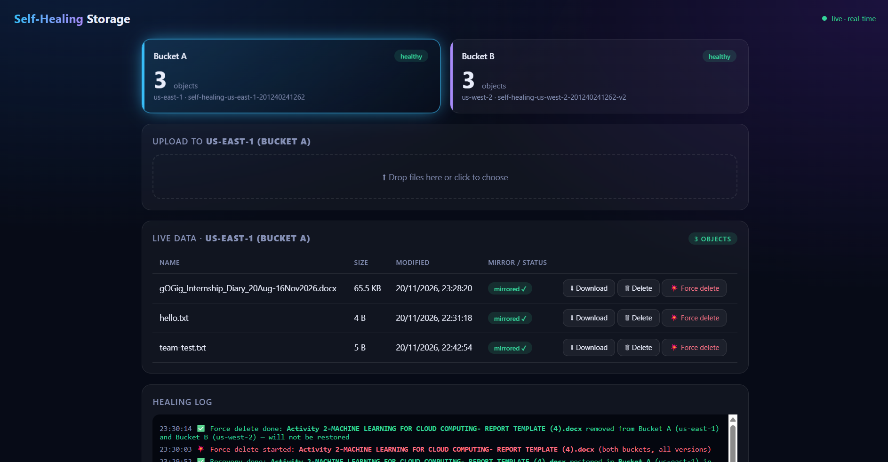
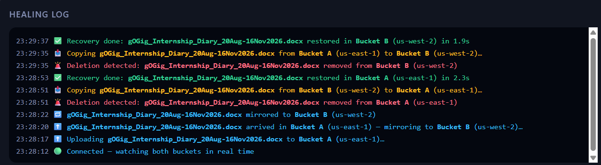
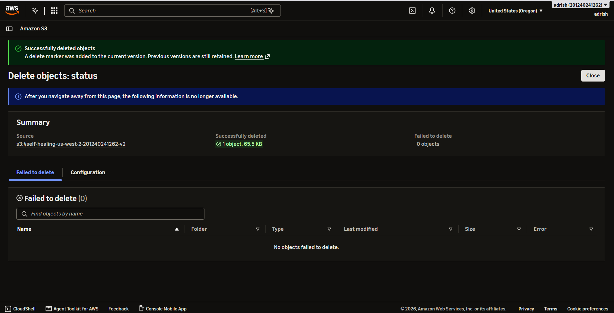
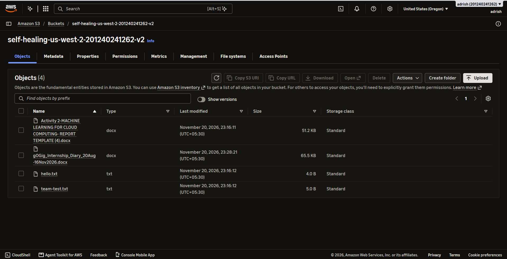

# Self-healing S3 bucket pair with a live dashboard

Two versioned S3 buckets in two regions mirror each other. If an object is deleted from **either** bucket, it is restored from its neighbour within a few seconds. A web dashboard (one Lambda behind an HTTPS Function URL) lets you upload, download, delete and force-delete files and watch healing happen in real time.

| | Bucket A | Bucket B |
|---|---|---|
| Region | `us-east-1` | `us-west-2` |
| Name | `self-healing-us-east-1-<account-id>` | `self-healing-us-west-2-<account-id>-v2` |

## Screenshots

**Dashboard: live data in each bucket**



**Healing log: deletion detected, copied from the neighbour, recovery done**



**Deleting a file in the S3 console (adds a delete marker)**



**Bucket B after healing: the file is back**



## How it works

| Event | What happens |
|---|---|
| Upload to A or B | The file is copied to the other bucket straight away. |
| A file is deleted from A or B | It is restored from the other bucket. If both copies were deleted, removing the delete marker restores the previous version. |
| Force delete (dashboard) | A temporary marker tells both healers to leave the file alone, every version is purged from both buckets, then the markers are removed. |
| Anything missed | A check every 5 minutes copies back any file missing from a bucket. |

S3's built-in replication is deliberately **not** used, because it spreads deletes. Instead each bucket has its own healer Lambda (`terraform/lambda/healer.py`) triggered by S3 events through EventBridge. Copies carry the metadata `sync-origin` so they never trigger another copy (no loops).

**Not supported:** recreating a deleted *bucket*. S3 keeps a deleted bucket name reserved for a while, so recreation under the same name can fail; only object-level healing is implemented.

## Deploy

Requires Terraform >= 1.5, Node.js and AWS credentials.

```bash
cd self-healing-s3-dashboard/dashboard
npm install --omit=dev            # bundles the AWS SDK into the Lambda package

cd ../terraform
cp terraform.tfvars.example terraform.tfvars   # set your own access_code
terraform init
terraform apply
```

Outputs: both bucket names and `dashboard_url`. Open the URL and enter the access code.

## Test healing

1. Upload a file in the dashboard; it appears in both buckets.
2. Delete it from either bucket (dashboard, S3 console or CLI). The log shows *Deletion detected -> Copying -> Recovery done*.
3. Use **Force delete** to remove a file from both buckets permanently.

## Clean up

```bash
terraform apply -var="healing_enabled=false"   # stop the healers first
terraform destroy
```

## Security note

The dashboard URL is public; data endpoints require the shared access code (header `x-access-code`). This is a test setup: anyone with the URL **and** the code can upload and delete in both buckets. Keep `terraform.tfvars` out of Git (it is git-ignored).

## Cost

A few cents when idle. The dashboard lists both buckets every second while a tab is open, which is about $1.75 per tab per 48 hours in S3 list requests.
